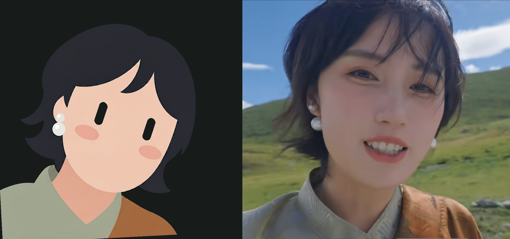
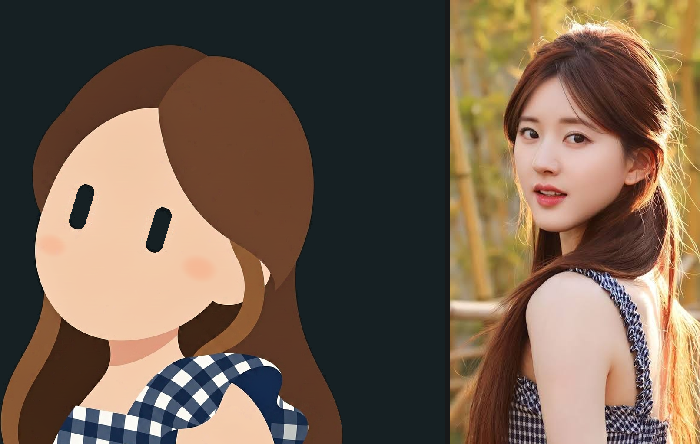
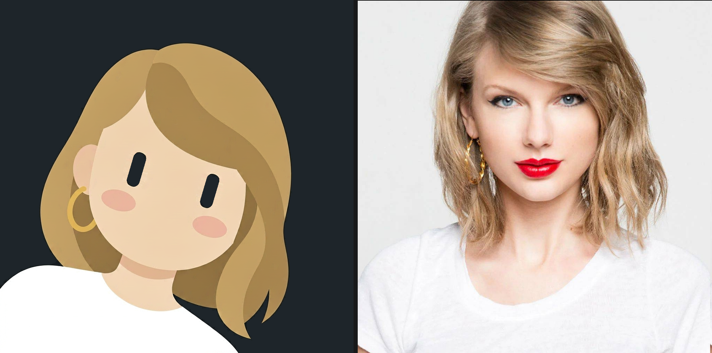
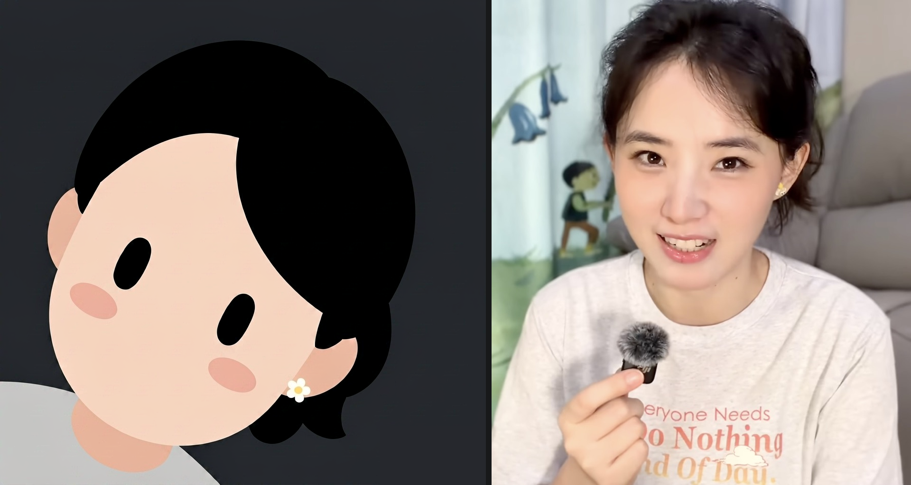

<div align="center">

# Photo to Cute Avatar

**把任意一张人物照片，重绘成一枚「黑色胶囊眼」极简 2D 机器人头像。**

近黑胶囊眼 · 无嘴无鼻 · 圆润大脸 · 头颈肩构图 · 顺时针倾斜 15–20° · 纯色背景

一个可直接安装使用的 Agent Skill（WorkBuddy / Claude Code 等支持 skills 的 Agent），
内含完整风格规范、9 个确定性后处理脚本与一整套**可量测**的自检标准。



</div>

---

## 📖 技能介绍 / What it is

这不是一句提示词，而是一套**「提示词 + 几何校正脚本 + 机器自检」**的完整流水线。

单纯让模型"画一个黑色胶囊眼的极简头像"，会稳定踩到四类坑：头部以下的身体被整块削掉只剩一颗悬浮的头、倾角方向随机、胶囊眼被画成胖椭圆、右下角带着 AI 水印。这个技能把每一条都变成了**可量测的数值**和**可复现的脚本**：先量测、再用确定性几何手段修，而不是反复重生成碰运气。

成品规范里最不可动摇的两条：**两颗没有任何装饰的近黑色纯色胶囊眼**，以及**没有嘴和鼻子的圆润机器人脸**。可爱感来自圆润比例与倾斜构图，不靠任何表情装饰。

**It's not a prompt — it's a pipeline.** A prompt alone reliably fails in four ways: the body gets amputated into a floating head, the tilt direction is random, the capsule eyes come out as fat ovals, and a watermark lands in the corner. This skill turns each of those into a *measurable number* and a *deterministic fix*: measure first, correct geometrically, never gamble on re-generation.

---

## 🖼️ 效果展示 / Showcase

> 每张对照图为**左：转换结果 ｜ 右：原图**。

### 案例 1 · 近黑短发 ＋ 珍珠耳饰 ＋ 高领

原图是一张复杂风景里的近景自拍（山脊、天空、草地）。成品只保留了三个识别特征——超短碎发、白色珍珠耳钉＋耳坠、灰绿高领与锈色披肩，背景整体替换为近黑深炭灰。


### 案例 2 · 栗棕长卷发 ＋ 蓝白格纹露肩上衣

长发全部归并成几个大而平滑的色块，保留原本的蓬松走向与量感；衣服只留下格纹与肩部色块，不加纽扣与图案细节。



### 案例 3 · 金棕波波头 ＋ 金色圈形耳环 ＋ 白 T 恤

原图发色偏浅、妆容浓（红唇、蓝眼影）——**这些都不会被复制**。保留的是金棕色波波头的轮廓与侧分走向，以及金色圈形耳环这一个关键识别特征。



### 案例 4 · 黑色盘发 ＋ 小花耳钉

同一套规范在深发色＋浅色衣领上的表现：头发压成两大块面，耳际一朵小白花是唯一的装饰。



---

## 🎨 风格规范 / Style rules

| 维度 | 规范 |
|---|---|
| **眼睛（最高优先级）** | 两颗近黑色**纯色**胶囊，长宽比 **2.5–3.0**，双眼**等大且平行**，每只眼的长轴**垂直于两眼中心连线**；禁止瞳孔／虹膜／眼白／高光／渐变／睫毛／眼皮／眉毛／任何形似数字「1」的钩状笔画 |
| **脸部** | 无嘴、无鼻、无微笑线、无猫嘴；下巴圆润，禁止尖下巴与写实骨骼结构；两颊小而浅的**低饱和椭圆腮红**，扁平色块、无线条无高光 |
| **构图** | 1:1 正方，**头部顺时针倾斜 15–20°（画面左侧的眼睛略高）**，脸／眼／发／饰品保持同一倾角；角色从画面**左下方**向画面内窥视，右上保留深色留白；**不绘制手与手臂** |
| **身体（本版重点）** | **颈部、衣领与肩／上半身必须出现在画面里**，肩部块面自然延伸到**底边与左边之外并被裁切**；不允许在脖子处齐平切断、也不允许悬空 |
| **头发与配色** | 简化为几个大而平滑的块面，**不描绘零散发丝**；保留原图的刘海方向与整体轮廓；几乎没有外轮廓线，靠相邻色块差异区分形状，**不用粗黑描边** |
| **背景** | 覆盖整幅的**近黑深炭灰**纯色（或用户指定的乳白）；不含任何背景物体、边框、文字、水印、闪粉、光晕 |

**冲突优先级**（规范冲突时自上而下取舍）：① 无装饰的黑色胶囊眼 → ② 无嘴无鼻的圆润脸 → ③ 双眼完整可见的倾斜特写构图 → ④ 原图的基础色与核心识别特征 → ⑤ 其他细节。

---

## 🚀 安装与使用 / Install & Usage

**1) 安装为 Agent Skill**

```bash
# WorkBuddy
git clone https://github.com/Leokencheng/photo-to-cute-avatar.git \
  ~/.workbuddy/skills/photo-to-cute-avatar

# Claude Code / 其他支持 skills 的 Agent（目录名保持 photo-to-cute-avatar）
git clone https://github.com/Leokencheng/photo-to-cute-avatar.git \
  ~/.claude/skills/photo-to-cute-avatar
```

**2) 使用**

直接把照片丢给 Agent，说「生成卡通头像」即可触发。技能会：

1. 从原图提取肤色、发色、发型轮廓与**最多 3 项**识别特征；
2. 用 `scripts/prerotate.py` **先把倾斜做在原图上**，再交给图像生成模型；
3. 逐版量测（`check_icon.py` / `check_body.py`），用 `fix_tilt.py` `slim_eyes.py` `add_blush.py` 做确定性修正；
4. 复验达标后交付 1:1 成品图。

**触发词**：卡通头像、Q版头像、可爱头像、卡通化、真人转卡通、机器人头像、胶囊眼图标 ／ cartoon avatar, chibi, cute avatar, robot icon, capsule eyes

**3) 环境依赖**

- Python 3（脚本自带 Pillow 引导：检测不到 Pillow 时自动切换到可用解释器，或在当前解释器里安装）
- 支持 image-to-image 的图像生成能力（本技能在 WorkBuddy 的 ImageGen 上实测，`input_fidelity: high`）

---

## 🧠 为什么它需要脚本 / Why the scripts matter

这一节是整个技能的核心——**四条踩过坑才得到的经验**，也是普通提示词方案做不到的地方：

**① 倾斜必须在生成前解决，而不是生成后补。**
模型有个稳定偏差：原图人物是正的，它也会画成右眼更高约 −10°；而规范要求左眼更高 15–20°，差着约 27°。如果生成之后再旋转整幅图补这 27°，会把**宽阔的肩部一起转成画面底部的一道斜条**——实测底部内容覆盖从 **43% 掉到 10%**，身体直接报废。
→ 正解是 `prerotate.py`：把原图先按需要的角度转好再交给模型，模型 follow 输入姿态很准，生成图天生就是目标倾角，后处理只需定位裁切。

**② 「包围盒裁切 + 放大填充」是身体的第二号杀手。**
它会把宽阔的肩部当作主体宽度，整幅放大到宽度撑满，高度溢出画布，底部对齐时再把溢出部分裁掉——结果只剩一颗悬浮的头。实测一张本身完美的头肩构图（底5% 55%、留白 上97 左161 下0）被旧流水线处理成 **底5% 10%、留白 上52 下165**。
→ `fix_tilt.py --keepbody` 只做「整幅等比缩放 + 左下锚定」，绝不按包围盒裁切填充。

**③ 眼睛不能按面积取 Top-2。**
头肩构图里「头发与手臂围出的颈部空洞」面积可达 **23708 px**，比真正的胶囊眼（5797 / 5750）还大，会把一只眼睛挤出榜单——量出来的倾角是 **−88.6°**、长宽比 0.74，全是假的。
→ `eyefind.py` 用**脸内部空洞 + 填充率**法（调色板无关）定位，并按「面积接近 ＋ 左右并排 ＋ 填充率高 ＋ 近黑」四条成对打分选眼。深炭灰背景下头发与眼睛几乎同色（实测 眼 rgb(32,33,39) vs 背景 rgb(32,34,35)），任何基于暗度的阈值都会失灵。

**④ 能机器量测的，就不要靠肉眼判断。**
`check_icon.py` 输出每只眼的长×宽×长宽比、顺时针倾角、双眼等大偏差；`check_body.py` 输出底部 5%/10%/15% 内容覆盖率、主体包围盒与四边留白。**底部覆盖 <25% 即判定「身体被截没」**，必须重做定位。基准样张 `assets/icon_girl.png`：主体 876×939，留白 上85 下0 左0 右148。

### 脚本清单

| 脚本 | 作用 |
|---|---|
| `eyefind.py` | **共用检出模块**：脸内部空洞法定位胶囊眼 + 正交测量框架（其余脚本都 import 它） |
| `prerotate.py` | 预旋转原图并裁内接正方形；`--expand` 抵消内接裁切自带的 1.22× 放大；`--shave` / `--padfrac` 消除边界接缝 |
| `check_icon.py` | 眼睛自检：长宽比 / 倾角 / 等大性 |
| `check_body.py` | 身体自检：底部覆盖率 / 包围盒 / 四边留白 |
| `fix_tilt.py` | 去水印 ＋ 多档背景色调统一 ＋ 微调倾角 ＋ 构图定位（`--keepbody`） |
| `slim_eyes.py` | 把偏胖的胶囊眼沿宽度收窄到规范长宽比，同时清掉边缘抗锯齿灰边 |
| `flatten_fringe.py` | 把锯齿状发际线重绘到滚动中位线（**默认跳过**，见脚本内注释） |
| `add_blush.py` | 确定性补腮红（模型经常整个漏画），带防叠加守卫 |
| `side_by_side.py` | 把成品与原图**等高不裁切**拼成左右对照图 |

---

## 📁 目录结构 / Layout

```
photo-to-cute-avatar/
├── SKILL.md              # 技能本体：风格规范 + 完整工作流 + 实测经验
├── scripts/              # 9 个后处理与自检脚本（纯 PIL，无第三方依赖）
├── assets/
│   └── icon_girl.png     # 构图基准样张（仅用于量测构图指标）
├── examples/             # 效果展示对照图（左：结果 ｜ 右：原图）
└── README.md
```

> **说明**：技能在本地使用时会额外保存原图与产物（`assets/` 下的历史输入样张、`output/` 下的成品）。`assets/` 中的历史输入样张均为**真人照片**，出于肖像考虑**未随本仓库发布**；`SKILL.md` 里对它们的引用仅用于本地调试图例。

---

## ⚠️ 免责与版权 / Disclaimer

- 本技能做的是**风格化演绎**，输出结果是极简卡通图标，**不是**原图人物的写实肖像，也不代表本人的任何授权或背书。
- `examples/` 中的对照图仅用于展示转换效果，其中所含**原图照片的著作权与肖像权归原作者／权利人所有**，请勿二次使用。
- 请仅对你自己拥有权利的图片使用本技能；用于他人图片时，请自行取得必要的许可。
- The showcase images in `examples/` are included **solely to demonstrate the transformation effect**. Copyright and portrait rights of the source photographs belong to their respective owners. Transformations are stylistic interpretations, not likenesses of, or endorsements by, the individuals depicted.

---

## 📄 License

[MIT](LICENSE) —— 代码与规范可自由使用、修改、分发（`examples/` 中的照片除外）。

<br>

---
---

<div align="center">

## 🇬🇧 English

</div>

# Photo to Cute Avatar

**Turn any portrait into a minimalist 1:1 flat 2D robot icon with near-black capsule eyes.**

Pure solid-color capsule eyes · no mouth, no nose · a big rounded face · head-and-shoulders framing · tilted 15–20° clockwise · solid near-black charcoal background.

### What it is

This isn't a prompt — it's a pipeline of **prompt + deterministic geometry-fixing scripts + machine self-checks**. Asking a model to "draw a minimal avatar with black capsule eyes" reliably fails in four ways: the body is amputated into a floating head, the tilt direction is random, the eyes come out as fat ovals, and an AI watermark lands in the corner. This skill converts each failure mode into a *measurable number* with a *repeatable fix*.

Two rules are non-negotiable: **two plain near-black solid capsule eyes with no ornamentation whatsoever**, and **a rounded robot face with no mouth and no nose**. The charm comes from rounded proportions and the tilted framing — never from facial expression.

### Style rules at a glance

| Aspect | Rule |
|---|---|
| **Eyes (highest priority)** | Two solid near-black capsules, aspect ratio **2.5–3.0**, identical in size and parallel, each eye's long axis **perpendicular to the line joining the two eye centers**. No iris, pupil, sclera, highlight, gradient, lashes, lids, brows, or any "numeral 1"-like stroke. |
| **Face** | No mouth, no nose, no smile line, no cat mouth. Rounded chin; no sharp chin, no realistic bone structure. Small, pale, low-saturation oval blush on both cheeks — flat blocks, no outline, no highlight. |
| **Composition** | 1:1 square. Head tilted **15–20° clockwise** (the eye on the left of the image sits slightly higher), with face, eyes, hair and accessories sharing the same tilt. Character peeks in from the **lower-left**; dark negative space kept in the upper-right. **No hands, no arms.** |
| **Body** | Neck, collar and shoulders/upper chest are **always visible**, running off the **bottom and left edges** of the frame — never cut flat at the neck, never floating in mid-air. |
| **Hair & palette** | Reduced to a few large smooth blocks, **no stray strands**; keeps the reference silhouette and fringe direction. Almost no outline strokes — shapes separated by adjacent color differences, never thick black outlines. |
| **Background** | Solid **near-black dark charcoal** (or off-white if requested) covering the whole canvas. No background objects, borders, text, watermarks, sparkles, or glow. |

Conflict priority (top wins): ① plain black capsule eyes → ② mouthless, noseless rounded face → ③ tilted close-up framing with both eyes fully visible → ④ the source's base colors and core identifying features → ⑤ everything else.

### Install & use

```bash
git clone https://github.com/Leokencheng/photo-to-cute-avatar.git \
  ~/.workbuddy/skills/photo-to-cute-avatar      # WorkBuddy
# or
git clone https://github.com/Leokencheng/photo-to-cute-avatar.git \
  ~/.claude/skills/photo-to-cute-avatar         # Claude Code / other skill-aware agents
```

Then hand a photo to your agent and say *"generate a cartoon avatar"*. The skill extracts skin tone, hair color and silhouette plus at most **three** identifying features, resolves the tilt **on the source image before generation**, measures the result, and applies deterministic fixes until every metric passes.

**Trigger words**: cartoon avatar, chibi, cute avatar, robot icon, capsule eyes, photo to cartoon ／ 卡通头像, Q版头像, 卡通化, 真人转卡通, 机器人头像

### The four hard-won lessons

1. **Fix the tilt before generation, not after.** Adding ~27° of rotation afterwards turns the wide shoulders into a diagonal stripe at the bottom of the frame — bottom-band coverage drops from 43% to 10%. `prerotate.py` rotates the *source* instead, so the generated image is already at the target tilt.
2. **"Bounding-box crop + enlarge-to-fill" is the body's second killer.** A flawless head-and-shoulders generation (bottom 5% coverage 55%) became a floating head (10%) after that step. `fix_tilt.py --keepbody` only does uniform scaling + lower-left anchoring.
3. **Never pick the top-2 eye candidates by area.** A neck-shaped hole between hair and arm can measure 23,708 px — larger than the real capsules (5,797 / 5,750) — producing a fake −88.6° tilt. `eyefind.py` finds eyes as *holes inside the face* and selects the best **pair** by area similarity, side-by-side placement, fill ratio and darkness.
4. **If it can be measured, don't eyeball it.** `check_icon.py` and `check_body.py` report aspect ratio, tilt, size deviation, bottom-band coverage and margins. Bottom coverage below 25% means the body was cropped away — redo the positioning.

### Repository layout

```
photo-to-cute-avatar/
├── SKILL.md              # the skill: style rules, full workflow, field-tested notes
├── scripts/              # 9 post-processing & measurement scripts (pure PIL)
├── assets/icon_girl.png  # composition benchmark (measurement reference only)
├── examples/             # before/after composites (left: result | right: source)
└── README.md
```

> The author's local working copy also keeps the sample input photos under `assets/`. Those are photographs of real people and are **deliberately not published** in this repository; references to them in `SKILL.md` are local debugging examples only.

### Disclaimer

The showcase images exist **only to demonstrate the transformation effect**. Copyright and portrait rights of the source photographs belong to their respective owners. Outputs are stylistic interpretations — not realistic likenesses of, and not endorsed by, the people depicted. Only use images you have the rights to.

### License

[MIT](LICENSE) for the code and specification (`examples/` photographs excluded).
